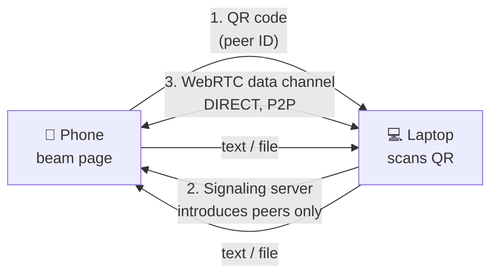

# Beam ⚡

**Send text & files from one device to another. No account. No app
install. No server ever reading your content.**

Open Beam on two devices, scan the QR code, and *whoosh* — it is there.

## Try it (needs two devices)

1. Open this page on device A (phone) and device B (laptop).
2. On device B, scan device A's QR code — or type A's code in.
3. Type text, or drop a file, and hit **Beam** ⚡.
4. It appears on the other side instantly, with a Copy button (text)
   or a Download link (files).

👉 **Live demo:** `https://jamescarterxyz.github.io/beam/`

## How it works



- **Peer-to-peer:** text and files travel directly between the two
  browsers over a WebRTC data channel.
- **Signaling only:** the free PeerJS cloud server introduces the two
  peers, then steps aside. It never sees your content.
- **Local history:** received texts are kept only in your own browser
  (localStorage). Nothing is stored on any server.
- **Session ends** automatically when either tab closes.

## Honest limits (v1)

- **No end-to-end encryption yet.** P2P already keeps content off
  servers, but the channel itself is not additionally encrypted —
  use Beam for everyday stuff, not secrets. E2EE is the planned v2.
- **Strict networks can block P2P.** Some corporate/school networks
  block WebRTC. If pairing fails there, that is why — a TURN relay
  fallback is the planned v2 fix.
- **Files** are transferred in 16 KB chunks; everyday files (photos,
  docs) are the v1 focus.

## Run it locally

```bash
# Beam needs http(s) — plain file:// will not do for service workers.
python3 -m http.server 8000
# then open http://localhost:8000 on two devices/browsers
```

## Tech

Plain HTML + CSS + JavaScript. No build step, no framework.
[PeerJS](https://peerjs.com/) (WebRTC) + a QR-code library, both from CDN.
Installable as a PWA (Add to Home Screen).

## Contribute

Good first contributions: themes and sound packs, translations,
PWA polish, the end-to-end encryption layer, a TURN fallback.
Open an issue first if you want to take on a bigger piece.

## License

MIT — free for everyone, forever.
